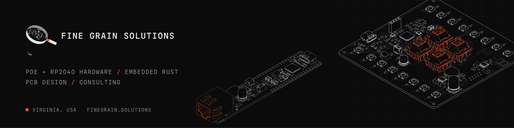

<picture>
  <source media="(prefers-color-scheme: dark)" srcset="assets/banner-dark.png">
  <source media="(prefers-color-scheme: light)" srcset="assets/banner-light.png">
  
</picture>

## Fine Grain Solutions

Fine Grain Solutions is a small hardware and firmware shop in Virginia. We design Power over Ethernet boards built around the RP2040, write embedded firmware in Rust, and take on PCB design and consulting work.

[finegrain.solutions](https://finegrain.solutions) · [Projects](https://finegrain.solutions/blogs/projects) · [𝕏 @fine_grain_sol](https://x.com/fine_grain_sol)

### Products

| Board | What it is | Status |
| --- | --- | --- |
| [RP PoE Hub](https://finegrain.solutions/products/rp-poe-hub) | Wall-mounted control panel on one Ethernet cable. W55RP20 (RP2040 + W5500), 802.3af PoE, four Cherry MX keys, 16 RGB LEDs, included I2C OLED, Qwiic. Talks to Home Assistant over MQTT. | Preorder, $129 early-bird, ships Q1 2027 |
| [RP PoE Pico](https://finegrain.solutions/products/rp-poe-pico) | Pico-format W55RP20 module with built-in 802.3af PoE, automatic PoE/USB-C power switch-over, Qwiic and SWD. | Preorder, $40, ships Q1 2027 |
| [BMW ADS Interface](https://finegrain.solutions/products/bmw-ads-interface) | Bidirectional KW-71 interface for pre-OBD2 BMWs over RS-232 (DB9). Optional 3D-printed enclosure. | With beta testers |

### What we do

- Hardware: PoE and Ethernet boards, RP2040 designs, 4-layer PCBs taken from schematic to assembled boards.
- Firmware: embedded Rust for the RP2040, built on Embassy.
- Consulting: PCB design, design for manufacture reviews, and bring-up help.

### Open source

We contribute upstream to the tools we use. Current work:

- [Backplane](https://github.com/i2cjak/Backplane), agentic hardware development with KiCad and STEP viewers. Our [fork](https://github.com/fine-grain-solutions/Backplane) carries Nix flake and release packaging, push webhooks, and a pairing token fix, headed upstream as pull requests.

### Contact

Through [finegrain.solutions](https://finegrain.solutions) or [𝕏 @fine_grain_sol](https://x.com/fine_grain_sol).
